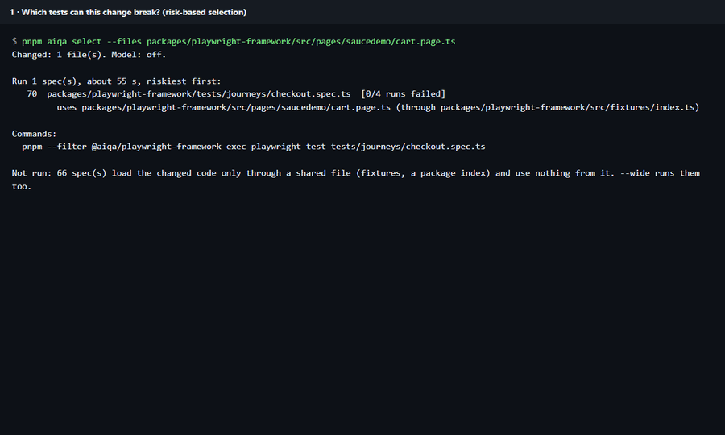

# AI-QA-Platform

[](https://github.com/logeshlodi/AI-QA-Platform/actions/workflows/ci.yml)

An AI-assisted Playwright + TypeScript automation platform, built as a pnpm monorepo and tested
against live public demo applications. It has cross-browser UI tests, API tests, a self-healing
engine with an audit trail, an optional local-model layer, run history with trends and flaky-test
detection, seeded test data, a code generator, Postgres/MongoDB/Kafka/RabbitMQ/gRPC suites against a real service,
browser performance checks and k6 load tests, the whole stack on Kubernetes with the tests running as
Jobs, test results, logs and traces in Grafana, and the same pipeline for GitHub Actions, Azure
DevOps and Jenkins. Every dependency is open source; nothing here needs a paid service.



Above: which specs a change can break, a spec reviewed against the house rules, triage of the last
run, the flaky-test hunter, and the run-history dashboard. Captured on the laptop with
`node scripts/demo-frames.mjs`; the [ten-minute walkthrough](docs/walkthrough.md) runs them live.

## Quick start (Windows `cmd`, macOS, Linux)

```bash
npx -y pnpm@10.34.5 install     # first install; pnpm is then a local dev dependency
npx pnpm browsers               # download Chromium, Firefox and WebKit (once)
# Windows: if the install fails with "EPERM ... symlink", close VS Code or run
#   powershell -ExecutionPolicy Bypass -File scripts\install-windows.ps1

npx pnpm test:unit              # engines: no browser, no network, about 2 seconds
npx pnpm test:api               # REST, GraphQL and SOAP against live APIs
npx pnpm test:smoke             # SauceDemo smoke on every browser and device project
npx pnpm test:ui                # everything: journeys, locator labs, feature labs, healing, visual
npx pnpm report:html            # open the last HTML report
npx pnpm report:dashboard       # open the run-history dashboard (trends, flaky tests, failures)
npx pnpm report:pdf             # the same as a PDF (--suite ui for one suite), in .aiqa/reports

npx pnpm test:chrome            # smoke in your installed Chrome   (test:edge for Edge)
npx pnpm test:lighthouse        # Lighthouse audit of the SauceDemo login page
npx pnpm test:shuffle           # Chromium run in a random order; prints the seed to replay it

npx pnpm stack:up               # Postgres, MongoDB, Kafka, RabbitMQ, the order service, Prometheus, Grafana (Docker)
npx pnpm test:data              # the data and messaging suites against that stack
npx pnpm stack:test             # one command: build, start, run the data suites in a container, stop
npx pnpm stack:down             # stop the stack and delete its data
npx pnpm test:contract          # Pact: consumer tests write the contracts, then the running service is checked

npx pnpm security               # licence allow-list, pnpm audit, OSV-Scanner (Docker)
npx pnpm security:zap           # OWASP ZAP attacks the order service's API, with a Keycloak token (needs stack:up)

npx pnpm test:perf              # Web Vitals, page weight, slow-phone run, memory leak check (Chromium)
npx pnpm perf:load              # k6 load test of the order service (needs stack:up); smoke | load | stress
npx pnpm aiqa perf              # performance metrics against their usual level, regressions first

npx pnpm aiqa new page Inventory --path /inventory.html --url   # page object + spec from the live page
npx pnpm aiqa data order --count 3 --seed 42                    # seeded test data as JSON
npx pnpm aiqa history           # recorded runs; `aiqa flaky` for the flaky list
```

Requires Node 24 LTS (22.22+ also works; see `.nvmrc`). If your global `pnpm` works you can drop the `npx` prefix.

## Packages

| Package                         | What it owns                                                                                                         | Tests                 |
| ------------------------------- | -------------------------------------------------------------------------------------------------------------------- | --------------------- |
| `packages/shared`               | Typed env config (zod), demo-target registry, logger, error types                                                    | Vitest                |
| `packages/ai-engine`            | `LlmProvider` interface, Ollama adapter, prompt templates, and five tasks (see "Optional: a local model")            | Vitest, fake provider |
| `packages/self-healing-engine`  | Fingerprints, four rule strategies plus a model tie-breaker, scoring, stores (memory, JSON, SQLite), heal report     | Vitest                |
| `packages/playwright-framework` | Fixtures, page objects, components, flows, checks, the Playwright healing adapter, all UI specs                      | Playwright            |
| `packages/api-framework`        | REST, GraphQL and SOAP clients, booking builder, zod schemas, API specs                                              | Playwright            |
| `packages/reporting-engine`     | History reporter, run stores (JSON, SQLite), pass-rate and duration trends, flaky detection, HTML dashboard and PDF  | Vitest                |
| `packages/test-data-engine`     | Seeded customer, product and order builders on zod schemas; `shop()` scenarios; optional model-written records       | Vitest                |
| `packages/cli`                  | `aiqa`: page and project generators, history, flaky, data, quiz, and the agents (`aiqa agents ...`)                  | Vitest                |
| `packages/ai-agents`            | Agent runtime on the AI SDK (tool budget, approval, run log, evals, memory) and eleven agents, each with rules first | Vitest, mock models   |
| `packages/mcp-server`           | The platform's MCP server: runs, failures, flaky tests, perf trends, heal audit, test data, triage                   | Vitest, MCP client    |
| `packages/dashboard`            | React components of the web app, a story per state, a gallery for Playwright's `mount`                               | Playwright components |
| `packages/examples`             | Eight break-it labs: a spec with one planted mistake and a reference solution that CI keeps green                    | Playwright            |
| `packages/templates`            | Starter projects for `aiqa new project`: UI, API or both, standalone, CI-tested                                      | Vitest, CI smoke      |
| `packages/interview-learning`   | 51 interview questions by topic and level, each pointing at the files that answer it                                 | Vitest                |
| `packages/data-framework`       | Postgres, MongoDB, Kafka, RabbitMQ and gRPC suites, the service's HTTP API, adapters, stack fixtures                 | Playwright, Docker    |
| `packages/mobile-framework`     | Native Android apps: Appium 4 and WebdriverIO in Playwright Test fixtures, screen objects, evidence                  | Appium, emulator      |
| `packages/contract-tests`       | Pact consumer tests (a storefront over HTTP, a notifications service over Kafka) and the provider check              | Vitest, Pact          |
| `packages/load-tests`           | k6 load test of the order service (smoke, load, stress), recorded in the run history                                 | Vitest, k6 in Docker  |
| `apps/order-service`            | The system under test: Kafka in, Postgres and MongoDB, Kafka and RabbitMQ out; HTTP and gRPC APIs; OpenTelemetry     | Data suites           |
| `apps/documentation`            | The docs site (Starlight) built from `docs/`, published to GitHub Pages                                              | Build, link check     |
| `apps/web`                      | Next.js app: dashboard, chat over the MCP tools with approvals, admin; Keycloak sign-in                              | Playwright e2e, axe   |

Import rule, enforced by ESLint: `shared` never imports Playwright, and the two engines never
import the test runner (the reporting engine may import its reporter types). Specs import the framework; the framework imports the engines; the
engines import `shared`.

## Performance testing

Two halves, because Playwright measures one user in great detail but cannot generate load.

**One user, in the browser** (`pnpm test:perf`, `packages/playwright-framework/src/perf/`):

- Core Web Vitals (LCP, CLS, INP, FCP, TTFB) measured inside the page by Google's `web-vitals`
  library, injected before the page's own scripts.
- A page-weight budget from Resource Timing: requests, bytes, scripts, images.
- The same page on a slow phone: Lighthouse's mobile profile (slow 4G, CPU four times slower) through
  the DevTools Protocol.
- A memory-leak check: add and delete a todo 40 times after a 20-round warm-up and compare the
  garbage-collected JavaScript heap.
- Optional Chrome performance traces (`PERF_TRACE=1`) for DevTools' Performance panel.

**Many users, against our own service** (`pnpm perf:load [smoke|load|stress]`, `packages/load-tests/`):
k6 places orders through `POST /orders` and times each one until `GET /orders/:id` reads
confirmed, through Kafka, Postgres and MongoDB. Thresholds fail the run; k6 streams its metrics
to Prometheus over OpenTelemetry, where the **Load tests (k6)** Grafana dashboard shows them next to the service's own
processing time. Load is only ever aimed at the order service, never at a public demo site.

Both record their numbers in the run history. `aiqa perf` and the dashboard compare each metric's
latest value with the median of its previous runs and flag regressions.

What the stress profile found on the laptop (19 to 20 Nov 2026), in three steps:

1. **The first bottleneck was the load test.** Polling every 25 ms sent 1,600 reads a second, which
   competed with the service for its five Postgres connections. Backing off (25 ms up to 500 ms)
   gave a fair baseline.
2. **The service handled Kafka messages one at a time.** At 150 offered orders a second it peaked at
   99 confirmed a second; end-to-end p95 reached 7.5 s and the end-to-end threshold failed.
3. **Handling the three partitions in parallel exposed a deadlock**: two orders reserving the same
   products in opposite line order. Locking product rows in SKU order fixed it; a concurrency spec
   that reproduces it failed 3 of 3 before the fix and passes after.

| Stress profile, same script and laptop | One message at a time | Partitions in parallel |
| -------------------------------------- | --------------------- | ---------------------- |
| Peak orders handled a second           | 99                    | 132                    |
| Order end-to-end p95                   | 7.54 s                | 1.31 s                 |
| Orders k6 had to drop                  | 2,316                 | 233                    |
| Thresholds                             | end-to-end crossed    | all held               |

`PARALLEL_PARTITIONS=false` on the order service brings back the old behaviour to compare.

## Where the specs are

```
packages/playwright-framework/tests/
  setup/      health check for every target, then one saved login
  smoke/      the cross-browser, cross-device gate
  journeys/   SauceDemo login and checkout flows (Chromium, Firefox, WebKit)
  locators/   one spec per locator type            (Chromium)
  features/   one spec per Playwright feature      (Chromium)
  healing/    self-healing on local pages and on a live dynamic-id page
  visual/     screenshot comparison with built-in toHaveScreenshot
  ai/         locator generation from an aria snapshot
  audits/     Lighthouse (its own `lighthouse` project)
  performance/ Web Vitals, page weight, slow-phone run, memory leak check (`perf` project, PW_PERF=1)
  seed.spec.ts  starting point for the Playwright test agents
packages/api-framework/tests/
  restful-booker/  auth, CRUD chaining, filtering, data-driven cases, schema-driven test data
  graphql/         Countries API
  soap/            calculator service
```

`docs/coverage-matrix.md` maps every locator type and feature to its spec file.

## Demo targets

SauceDemo, Restful-Booker, The Internet, UI Testing Playground, Playwright's TodoMVC and
API-mocking demos, the Countries GraphQL API and a public SOAP calculator. The `setup` project
pings each one first. If a target is down, its specs are **skipped** with a `target-down`
annotation rather than failed. To use a local copy, set for example
`TARGET_SAUCEDEMO_URL=http://localhost:3200`.

## Self-healing

```ts
const pay = await healer.locate('PayPage.payButton', page.locator('#btn-1001'));
```

While the locator works, its element is fingerprinted. When it stops working, the engine scores
the elements on the page against that fingerprint and heals only if exactly one is a clear match
(score at least `HEAL_THRESHOLD`, default 0.75, and ahead of the runner-up). Otherwise it refuses
and attaches what it saw.

| `HEAL_MODE`         | Behaviour                                                                   |
| ------------------- | --------------------------------------------------------------------------- |
| `off`               | Plain Playwright                                                            |
| `suggest` (default) | The test fails; the report carries the suggested locator as a diff          |
| `runtime`           | The run continues with the healed element; the heal is logged and annotated |

Source files are never rewritten. See `tests/healing/` for runnable examples.

## Optional: a local model

AI is off by default and nothing depends on it. To turn it on:

```bash
ollama pull qwen2.5-coder:7b
# then in .env
AI_ENABLED=true
```

The model has five jobs. Each one has a fallback that needs no model, so no test depends on it:

| Task               | What it does                                                           | When AI is off                 |
| ------------------ | ---------------------------------------------------------------------- | ------------------------------ |
| Locator tie-break  | Picks one element when several pass the healing threshold              | The heal is refused            |
| Failure analysis   | Labels a failure product, test, environment or flaky, with a reason    | Rules only; the rest "unknown" |
| Bug-report draft   | Writes Summary, Steps, Expected, Actual from the test's facts          | A plain template is filled in  |
| Locator generation | Turns "the Login button" plus an aria snapshot into a `getByRole` call | Rules only (exact name match)  |
| Schema-driven data | Writes a test record that fits a zod schema and a scenario in words    | The faker builder is used      |

JSON answers are validated against a schema, and where the model chooses an element it can only pick
from a list it is given. `AI_ENABLED=true npx pnpm test:ai` runs all five against the real model
(about 40 seconds per call on a CPU-only laptop).

## Playwright test agents

`packages/playwright-framework/.claude/agents/` holds Playwright's own planner, generator and healer
agents, created with `npx playwright init-agents --loop=claude`. They start from `tests/seed.spec.ts`
(a logged-in SauceDemo session on this project's fixtures) and write plans to `specs/`.
See `packages/playwright-framework/specs/README.md` for other tools (VS Code, Copilot, Codex).

## Agents and the MCP server

Eleven agents, each with one job, a tool budget and a rules fallback, and a memory of people's decisions; [ADR 0014](docs/adr/0014-agents-rules-first-on-the-ai-sdk.md) sets the rules.

```bash
npx pnpm aiqa agents triage --suite api          # why each failed test of the latest run failed
npx pnpm aiqa agents eval triage                 # score Triage on its 30 labelled failures
npx pnpm aiqa agents plan inventory --path /inventory.html --logged-in   # a test plan from the live page
npx pnpm aiqa agents generate specs/inventory.plan.md --scenario 1       # a spec that must pass 3 runs
npx pnpm aiqa agents heal-review --apply --branch                        # healed locators as patches on a local heal/* branch, after your yes
npx pnpm aiqa agents flaky --suite api          # flaky tests, rerun, with the likely cause
npx pnpm aiqa agents a11y --path /inventory.html --logged-in            # axe findings ranked by user impact
npx pnpm aiqa agents report --suite ui           # a summary whose every number is checked
npx pnpm agents:eval:all                         # every agent with an eval (ten), recorded
npx pnpm aiqa agents log                         # every agent run: tools called, answer, model, time
npx pnpm aiqa select --budget 10                 # the specs this branch can break, riskiest first, in 10 minutes
npx pnpm aiqa agents review                      # changed specs against CONTRIBUTING's standards, by line
npx pnpm aiqa agents feedback triage <id> product --note "BUG-311"   # correct triage once; it remembers
npx pnpm mcp                                     # the platform's MCP server on stdio
```

Agents answer from rules when no model is configured. Set `AI_ENABLED=true` for the local Ollama model,
or `AGENT_PROVIDER=openai-compatible` with `AGENT_BASE_URL`, `AGENT_MODEL` and `AGENT_API_KEY` in `.env`
for a hosted one. Claude Code picks up the MCP server from `.mcp.json` as `aiqa`.

## Web app

`apps/web` shows the run history, a run's tests, trends, flaky tests, the heal audit and the agent run
log in the browser, behind a Keycloak sign-in ([ADR 0015](docs/adr/0015-one-nextjs-app-and-stories-for-components.md)).
Its chat answers from the platform's MCP tools and holds every change it asks for until a platform
admin approves it; the admin area sets the chat's budget and lists quarantined tests
([ADR 0016](docs/adr/0016-chat-over-mcp-with-approval-and-a-stub-model.md)).

```bash
npx pnpm stack:up            # Keycloak, with the web client and two test users
npx pnpm web                 # http://localhost:3200, sign in as qa-viewer / dev-only-qa-viewer-password
npx pnpm test:components     # the shared components: behaviour and axe on every story
npx pnpm test:web            # sign-in, every page on fixed data, chat and admin on a stub model, axe
# Test users: qa-viewer / dev-only-qa-viewer-password, qa-admin / dev-only-qa-admin-password
```

## Run history and the dashboard

`pnpm test:ui` and `pnpm test:api` record every run to `.aiqa/history` (SQLite when Node has it,
one JSON file per run otherwise) and rebuild `.aiqa/dashboard/index.html`. That page shows each
suite's latest result, pass-rate and duration trends, flaky tests, the latest failures with their
likely cause, the slowest tests and a run log. A run of a single spec (`playwright test some.spec.ts`)
is not recorded, so the trend lines only ever compare whole-suite runs.

A test counts as **flaky** when it passed only on a retry, or flipped between green and red at least
twice in the last 20 runs. Going green to red and staying red is a regression, not flakiness, and
shows up under failures instead.

## Data and messaging suites

`apps/order-service` reads orders from Kafka, stores them and reserves stock in Postgres in one
transaction, writes an audit trail to MongoDB, and publishes confirmed, rejected or dead-letter
events. `packages/data-framework` tests it from the outside: schema and constraints, data-quality
queries over every stored order, the audit index, Kafka partition ordering, and the full flow for
a confirmed order, too little stock, an unknown SKU, a duplicate delivery and four invalid messages.

Grafana at http://localhost:3200 shows the service while the suites run (orders by outcome,
processing time p50 and p95); Prometheus is at http://localhost:9090.

## Security

The Docker stack includes Keycloak (http://localhost:8180, admin / admin) with a local test realm.
Product writes (`PUT /products/{sku}`) need an OAuth 2.0 bearer token with the `catalog-admin`
role; ordering and reading stay open. `data-framework/tests/http/auth.spec.ts` gets real tokens and
checks every refusal: no token, Basic credentials, a valid token without the role (403), a token for
another API, an expired token, claims edited after signing, and an unsigned `alg: none` token.

`pnpm security` checks every dependency's licence against an open-source allow-list and looks for
known vulnerabilities with `pnpm audit` and OSV-Scanner; accepted findings are in `osv-scanner.toml`
with a reason and an expiry date. `pnpm security:zap` runs OWASP ZAP's API scan against the order
service from its own OpenAPI document, logged in; injection-class findings fail it. CI runs both.

## Kubernetes and monitoring

The whole stack also runs on a local [kind](https://kind.sigs.k8s.io) cluster from one Helm chart
(`infrastructure/kubernetes/aiqa-stack`), with the suites running as Kubernetes Jobs:

```bash
pnpm k8s:up                 # create the cluster, build and load the images, install the chart
pnpm k8s:test data          # data suites as a Job
pnpm k8s:test ui            # UI specs as a Job, browsers on the shared Playwright server
pnpm k8s:test ui all-browsers   # the same on Chromium, Firefox and WebKit
pnpm k8s:test load smoke    # k6 as a Job (smoke, load or stress)
pnpm k8s:status
pnpm k8s:down
```

UI Jobs do not launch browsers: they connect to one shared `playwright run-server` in the cluster.
Every Job pushes its results to Prometheus, and Grafana (http://localhost:30300) shows the tests
next to the service: pass rate, duration, flaky tests, the slowest tests and performance trends.
Loki holds the logs of every pod and Tempo the order service's traces, linked both ways. The web
app runs there too (http://localhost:30200), signed in through the chart's own Keycloak. Needs
Docker Desktop, `kind`, `kubectl` and `helm`; see `infrastructure/kubernetes/README.md` and
`infrastructure/monitoring/README.md`.

## Docker and CI

```bash
docker compose -f infrastructure/docker/docker-compose.yml up --build tests        # whole suite
docker compose -f infrastructure/docker/docker-compose.yml run --rm snapshots      # refresh Linux visual baselines
```

GitHub Actions (`.github/workflows/ci.yml`) runs type-check, lint and unit tests, the API specs,
the UI specs in three shards with a merged report, smoke in real Chrome and Edge, the Lighthouse
audit, the visual check against Linux baselines, browser performance, a k6 smoke test, the data
suites on the Docker stack, and the Pact contracts (kept as an artifact). Every job uses one shared setup action
(`.github/actions/setup`): Node, pnpm, a cached install, and Playwright browsers matched to the
installed Playwright version and cached per version, so a Playwright update never needs a workflow
change. Each run page shows a summary with the recent runs and the flaky list.

A second workflow (`.github/workflows/kubernetes.yml`) runs nightly and on request: it builds the
whole stack on a kind cluster with `pnpm k8s:up`, exactly as on a laptop, then runs the data, UI and
load suites as Kubernetes Jobs and keeps their reports as an artifact.

Dependabot pull requests can merge themselves once CI is green (patch and minor only): set the
repository variable `DEPENDABOT_AUTOMERGE` to `true` (Settings > Secrets and variables > Actions >
Variables). See `.github/workflows/dependabot-automerge.yml`. The API job and the shard-merge job
record history in the Actions cache and upload the dashboard as an artifact (`api-dashboard`,
`ui-dashboard`).

The same stages run on **Azure DevOps** (`azure-pipelines.yml`, templates in
`infrastructure/azure-devops/`) and **Jenkins** (`Jenkinsfile`, set-up notes in
`infrastructure/jenkins/README.md`). Dependabot (`.github/dependabot.yml`) groups weekly updates.

## Useful switches

| Variable                                                                               | Effect                                                                        |
| -------------------------------------------------------------------------------------- | ----------------------------------------------------------------------------- |
| `PW_CHANNEL=chrome` or `msedge`                                                        | Run the `chromium` project in your installed browser                          |
| `PW_BRANDED_BROWSERS=chrome,msedge`                                                    | Add smoke runs in real Chrome and Edge (`pnpm test:chrome`, `pnpm test:edge`) |
| `LH_MIN_PERFORMANCE`, `LH_MIN_ACCESSIBILITY`, `LH_MIN_BEST_PRACTICES`, `LH_MIN_SEO`    | Lighthouse score floors for `pnpm test:lighthouse`                            |
| `HEAL_MODE`, `HEAL_THRESHOLD`, `AI_ENABLED`, `OLLAMA_URL`, `OLLAMA_MODEL`, `LOG_LEVEL` | See `.env.example`                                                            |
| `PW_WS_ENDPOINT=ws://localhost:30333/`                                                 | Run the browsers on a Playwright browser server instead of locally            |
| `AIQA_PUSHGATEWAY=http://localhost:30091`                                              | Push each run's results to Prometheus for the Grafana "Test runs" dashboard   |

## Learning path

[`docs/learning`](docs/learning/README.md) turns the repository into a course: fifteen stops, each with
a guide to read, a command to run, a lab to fix and a quiz to check yourself. The same pages, with the
ADRs, the coverage matrix and the status, are published as a site:
https://logeshlodi.github.io/AI-QA-Platform/ (`pnpm docs` runs it locally).

```bash
pnpm lab                      # list the break-it labs; pnpm lab 03 runs one
pnpm test:labs                # every lab solution (CI runs this)
pnpm aiqa quiz --topic api    # interview questions; --list prints them with answers
```

## Roadmap

| Phase | Sprints                 | What                                                                                                 | State |
| ----- | ----------------------- | ---------------------------------------------------------------------------------------------------- | ----- |
| 1-3   | 1-5                     | Working core: framework, locator and feature labs, API tests, self-healing, the AI layer             | Done  |
| 4     | 6-8                     | Run history and dashboard, test data, CLI, data and messaging suites, Azure DevOps, Jenkins, Grafana | Done  |
| -     | Performance, Kubernetes | Web Vitals and k6 with trends; kind, Helm, test Jobs, test metrics, Loki and Tempo                   | Done  |
| -     | Contracts               | OpenAPI document and response validation for the order service; Pact consumer and provider           | Done  |
| -     | Security                | Keycloak OAuth/JWT on product writes; licence, audit and OSV gates; authenticated ZAP API scan       | Done  |
| -     | Learning                | Learning path and ten guides, eight break-it labs, interview question bank and `aiqa quiz`           | Done  |
| 5     | 9-14                    | Nine agents, MCP server, web app (dashboard, chat, admin), docs site, project templates              | Done  |

`docs/architecture.md` explains how the parts fit together, and `docs/adr/` records the decisions
behind them. To show it to someone, follow the [ten-minute walkthrough](docs/walkthrough.md). To work on the repository, start with [`CONTRIBUTING.md`](CONTRIBUTING.md); the docs
site also has a Playwright cheat sheet, a Selenium-to-Playwright guide and a troubleshooting page.

## Start your own project

```bash
pnpm aiqa new project checkout-tests --kind both --dir ../checkout-tests   # ui, api or both
```

A standalone npm project at this repository's Playwright and TypeScript versions, on its patterns
(page objects behind fixtures, role locators, no fixed waits). CI generates each kind and runs its
tests. See `packages/templates`.

## Status

See `docs/STATUS.md` for what has been run, where, and what is not built yet.

## Licence

Apache-2.0. See `NOTICE` for the projects this design draws on.
